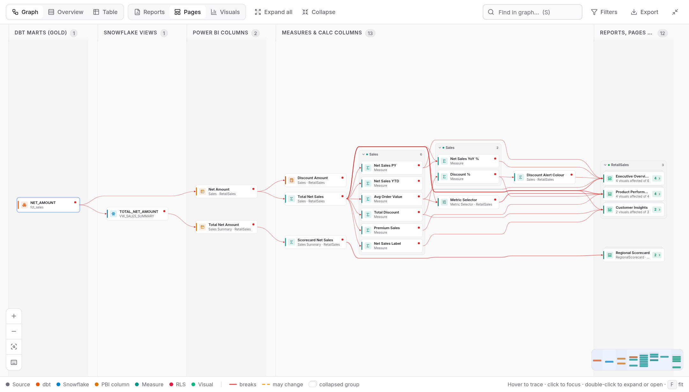
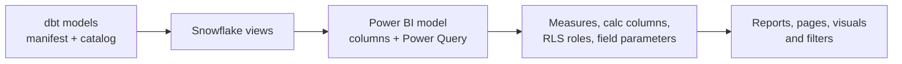
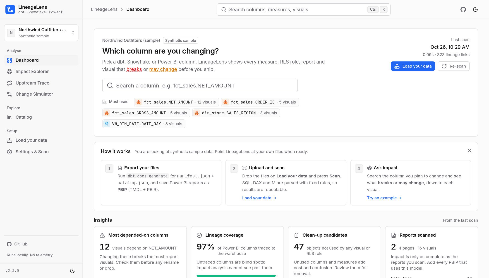
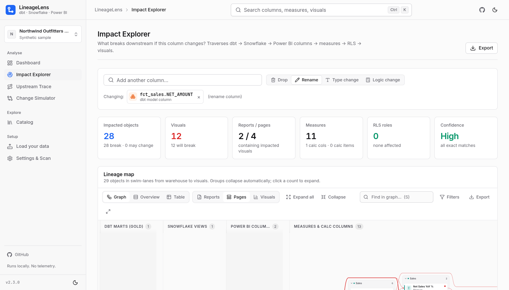
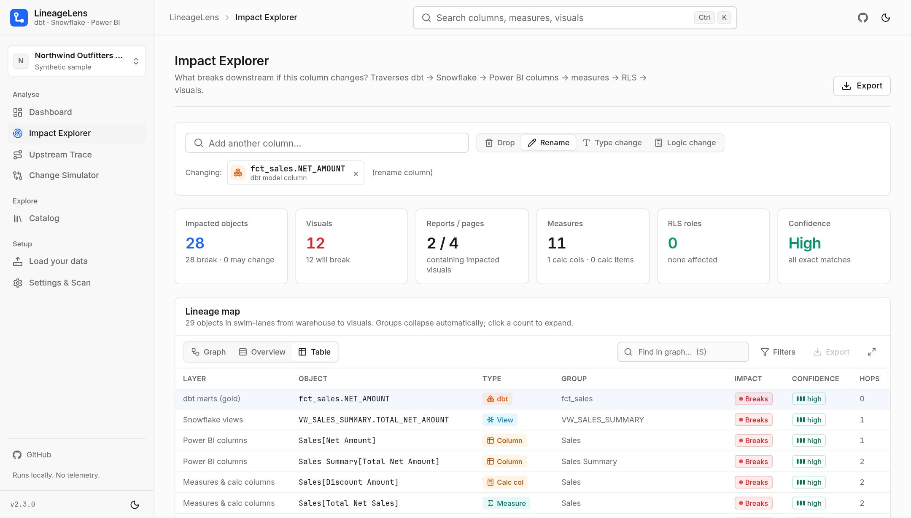
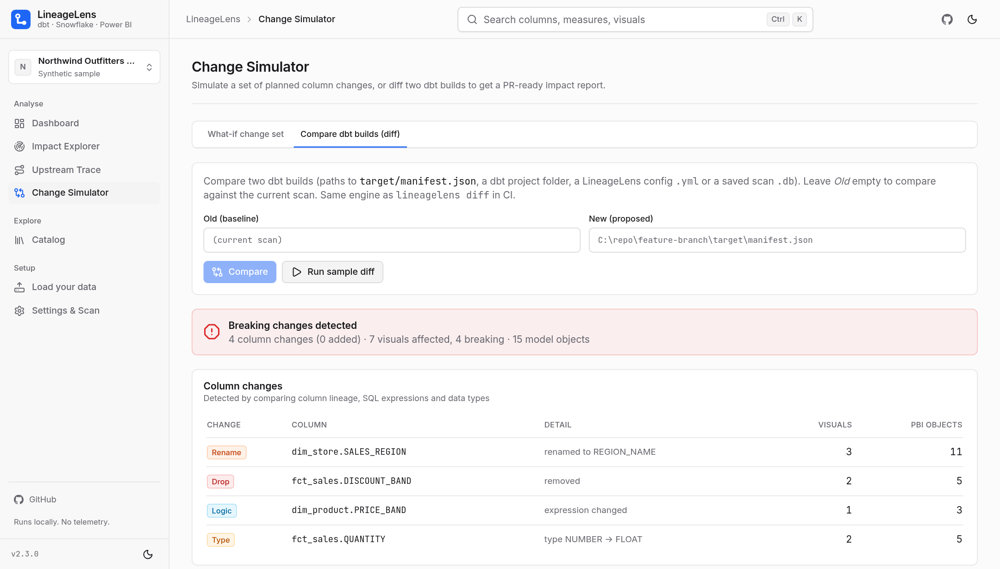
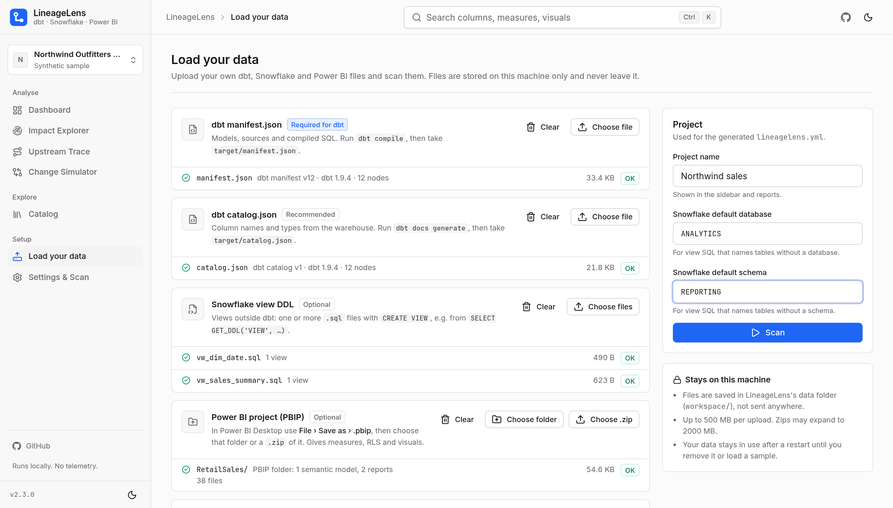

<div align="center">

<picture>
  <source media="(prefers-color-scheme: dark)" srcset="docs/brand/logo-dark.svg">
  
</picture>

**See which Power BI visuals, measures and RLS roles break before you change a dbt or Snowflake column.**

[](https://github.com/dhruvpuri-goswami/LineageLens/actions/workflows/ci.yml)
[](LICENSE)


<picture>
  <source media="(prefers-color-scheme: dark)" srcset="docs/screenshots/hero-dark.png">
  
</picture>

</div>

## The problem

Renaming or dropping a gold-layer column is easy in dbt. Finding out what it breaks in Power BI is not: the column passes through Snowflake views, Power Query, the semantic model, DAX measures, RLS filters and finally visuals on report pages that nobody remembers.

## What it answers

- **If I rename or drop this column, which visuals, pages and reports break?**
- **Which measures, calculated columns, calculation items and RLS roles use it,** directly or through other measures?
- **Which values only *may change*** (the column is used in a join, filter or expression), and how sure is each match?
- **Where does this visual's number come from?** Trace any visual, measure or RLS role back to the source columns.



Everything runs on your machine. Parsing is deterministic (sqlglot for SQL plus plain rules for DAX, M, TMDL and PBIR): **no AI, LLM or RAG**, no telemetry, and the same input always gives the same answer.

## Walk-through: renaming `fct_sales.NET_AMOUNT`

**1. Start from the dashboard.** Search the column you plan to change. The insight cards show the riskiest columns, lineage coverage and clean-up candidates.



**2. Pick the change type.** Choose *Rename*. In the bundled sample that hits 28 objects: 12 visuals on 4 pages in 2 reports, and 11 measures. Each item is marked **breaks** or **may change**, with a confidence level and the full path.



**3. Review the list.** Switch the lineage map to *Table* for a sortable list, or export it as HTML, Excel, CSV or JSON for the pull request.



**4. Check a whole change set.** The Change Simulator combines several planned changes, or compares two dbt builds and lists every renamed, dropped, retyped or rewritten column with its Power BI impact.



## Features

| | |
|---|---|
| **Impact Explorer** | Drop, rename, type or logic change. Breaks vs may change, confidence, full path. Export to HTML, XLSX, CSV, JSON. |
| **Readable lineage map** | Swim lanes per layer, auto-collapsing groups, hover-to-trace, focus a path, filters, search, minimap, overview and table modes, PNG/SVG export. |
| **Upstream Trace** | From a visual, measure or RLS role back through DAX, Power Query, Snowflake and dbt to the raw sources. |
| **Change Simulator** | What-if change sets, and diffs of two dbt builds into a PR-ready markdown report. |
| **Catalog and clean-up** | Every object with downstream counts. Find unused gold columns and unused Power BI objects. |
| **Load your data** | Upload dbt, Snowflake and Power BI files in the browser. No config file needed. |
| **CLI and CI gate** | `lineagelens diff --fail-on breaking` fails a pull request that would break Power BI. |
| **Local and private** | Binds to `127.0.0.1`, no outbound calls by default, hardened Docker image, light and dark themes. |

## Quick start

**Docker** (recommended)

```bash
git clone https://github.com/dhruvpuri-goswami/LineageLens.git && cd LineageLens
docker compose up -d
```

**Windows** (Python 3.11+)

```powershell
git clone https://github.com/dhruvpuri-goswami/LineageLens.git; cd LineageLens
powershell -ExecutionPolicy Bypass -File setup.ps1 -Run   # or double-click start.bat
```

**macOS / Linux** (Python 3.11+)

```bash
git clone https://github.com/dhruvpuri-goswami/LineageLens.git && cd LineageLens
./start.sh                                                  # or: make install && make run
```

Open **http://127.0.0.1:8765**. The synthetic sample project is loaded, so you can try everything straight away.

## Use your own data

**Option 1: upload in the app.** Open **Load your data** (sidebar, or the button on the dashboard), drop your files, fill in the default Snowflake database and schema, and press **Scan**.



| Drop zone | What to give it |
|---|---|
| `manifest.json` (required for dbt) | `target/manifest.json` from `dbt compile` |
| `catalog.json` (recommended) | `target/catalog.json` from `dbt docs generate` |
| Snowflake view DDL (optional) | `.sql` files with `CREATE VIEW`, e.g. from `GET_DDL('VIEW', …)` |
| Power BI project (optional) | The PBIP folder or a `.zip` of it (*File ▸ Save as ▸ .pbip*). Gives measures, RLS and visuals. |
| `.pbix` (fallback) | Report layout only: pages and visuals. Measures and RLS need PBIP. |

Each file is checked as soon as it arrives. Files are stored in the app's data folder (`workspace/`), stay in use after a restart, and **Remove my data** deletes them and goes back to the sample.

**Option 2: a folder and a config file.** Put your exports in `./inputs` with a `lineagelens.yml` (see [`inputs/README.md`](inputs/README.md)), then `docker compose restart`. Without Docker: `lineagelens init lineagelens.yml`, edit the paths, `lineagelens serve -c lineagelens.yml`. You can also edit the YAML in **Settings & Scan**.

<details>
<summary><b>Input reference</b>: dbt, Snowflake, Power BI</summary>

**dbt.** LineageLens reads dbt artifacts, not Jinja.

```bash
dbt deps
dbt compile            # target/manifest.json with compiled SQL for every model
dbt docs generate      # target/catalog.json with real column names and types
```

- `compiled_code` in the manifest is what gets parsed. Models without compiled SQL are listed as warnings.
- `catalog.json` is optional but strongly recommended: it lets `SELECT *` and unqualified columns resolve exactly.
- `dbt.project_dir` expects a `target/` folder. You can also set `manifest:` / `catalog:` explicitly.

**Snowflake views not managed by dbt.** Either a folder of DDL scripts (`snowflake.view_dirs`), where each file holds one or more `CREATE [OR REPLACE] [SECURE] VIEW … AS SELECT …`, or live read-only metadata (see *Optional connections* below).

**Power BI: save as PBIP (TMDL + PBIR).** The binary `.pbix` model cannot be parsed reliably.

1. *File ▸ Options and settings ▸ Options ▸ Preview features*: enable **Power BI Project (.pbip) save option**, **Store semantic model using TMDL format** and **Store reports using enhanced metadata format (PBIR)**. Recent Desktop builds use PBIR/TMDL by default.
2. *File ▸ Save as ▸ Power BI project (*.pbip)*.
3. You get `MyReport.SemanticModel/` and `MyReport.Report/` (PBIR `definition/` or legacy `report.json`). Commit them to git.
4. List them in `powerbi.semantic_models` / `powerbi.reports`, or a parent folder in `powerbi.search_dirs`.

Thin reports are matched to their model by name; override with `powerbi.report_model_map`. `.pbix` files give the report layer only.

**Exact DAX dependencies (optional).** Run `EVALUATE INFO.CALCDEPENDENCY()` in DAX Studio, save it as CSV and set `powerbi.calcdependency_csv: {ModelName: path.csv}`. Those links are added with high confidence.

**Samples.** Only synthetic data ships with the app: *Northwind Outfitters* (standard, about 210 objects) and *Helios Retail Group* (large, about 940 objects, 7 reports, 151 visuals). Switch in **Settings & Scan**, or run `lineagelens serve --sample large`.

</details>

<details>
<summary><b>Configuration</b>: <code>lineagelens.yml</code> and environment variables</summary>

Paths are relative to the config file unless you set `base_dir`. `~`, `%VARS%` and `$VARS` are expanded.

```yaml
project_name: Contoso analytics
dbt:                                   # one or more dbt projects
  - project_dir: ../dbt-gold           # uses target/manifest.json and target/catalog.json
    manifest: null
    catalog: null
snowflake:
  view_dirs: [../snowflake/views]      # CREATE VIEW scripts not managed by dbt
  default_database: ANALYTICS          # used for unqualified names
  default_schema: REPORTING
  live: { enabled: false, databases: [ANALYTICS], schemas: [] }
powerbi:
  semantic_models: [../powerbi/Sales.SemanticModel]  # TMDL folders or model.bim
  reports: [../powerbi/Sales.Report]                 # PBIR or legacy report.json folders
  pbix: []                                            # report layer only
  search_dirs: [../powerbi]                           # auto-discover *.SemanticModel / *.Report / *.pbix
  report_model_map: { "Exec Overview": "Sales" }      # thin report -> model name
  calcdependency_csv: { Sales: ../exports/sales_calcdep.csv }
  fabric: { enabled: false, workspaces: [] }
naming:                                # how PBI column names map to warehouse columns
  case_insensitive: true
  strip_prefixes: [DIM_, FCT_]
  strip_suffixes: [_KEY]
  regex_map: [{ pattern: "^AMT_", replace: "AMOUNT_" }]
  enable_fuzzy: true                   # fuzzy matches are labelled "low" confidence
  fuzzy_threshold: 90
database: null                         # SQLite file for the saved graph; default: data folder
base_dir: null
```

Which data is shown: `--config` / `--sample` on the command line, then uploaded data, then `LINEAGELENS_CONFIG`, then the sample.

| Variable (env or `.env`) | Default | Meaning |
|---|---|---|
| `LINEAGELENS_HOST` | `127.0.0.1` (`0.0.0.0` in Docker) | Bind address |
| `LINEAGELENS_PORT` | `8765` | Port |
| `LINEAGELENS_PUBLISH_PORT` | `8765` | Docker only: host port on 127.0.0.1 |
| `LINEAGELENS_HOME` | `%LOCALAPPDATA%\LineageLens` / `~/.lineagelens` (`/data` in Docker) | Saved graphs and uploaded files |
| `LINEAGELENS_CONFIG` | none (`/inputs/lineagelens.yml` in Docker) | Config file; falls back to the sample when missing |
| `LINEAGELENS_SAMPLE` | `standard` | Sample without a config: `standard` or `large` |
| `LINEAGELENS_ALLOW_UPLOAD` | `true` | Enable **Load your data** |
| `LINEAGELENS_MAX_UPLOAD_MB` | `500` | Largest single upload request |
| `LINEAGELENS_MAX_UNZIPPED_MB` | `2000` | Largest total size of an extracted `.zip` |
| `LINEAGELENS_MAX_ZIP_FILES` | `20000` | Most entries in one `.zip` |
| `LINEAGELENS_ALLOWED_ROOTS` | none (`/inputs:/data` in Docker) | Paths typed in the UI must stay inside these (`;`-separated) |
| `LINEAGELENS_ALLOWED_HOSTS` | `127.0.0.1,localhost,[::1]` | Accepted `Host` headers |
| `LINEAGELENS_ALLOW_CONFIG_WRITE` | `true` | Allow saving YAML from Settings |
| `LINEAGELENS_MAX_BODY_MB` | `5` | Largest non-upload request body |
| `LINEAGELENS_LOG_LEVEL` | `info` | `debug` … `critical` |
| `LINEAGELENS_LOG_FORMAT` | `text` (`json` in Docker) | Log format |
| `LINEAGELENS_ENABLE_DOCS` | `false` | Swagger UI at `/api/docs` (loads CDN assets) |
| `BUYMEACOFFEE_URL`, `GITHUB_REPO_URL` | see `lineagelens/links.py` | Sidebar links; empty or `YOUR_USERNAME` hides them |

Copy `.env.example` to `.env` to change them. `lineagelens serve` also reads `.env` in the current folder (real environment variables win).

**Docker notes.** The port is published on `127.0.0.1` only. `./inputs` is mounted read-only; saved graphs and uploads live in the `lineagelens-data` volume (`docker compose down -v` removes it). Logs: `docker compose logs -f`. `docker compose ps` shows `healthy`.

**Other installs.** Manual: `python -m venv .venv`, `.venv/bin/pip install --require-hashes -r requirements.lock`, `.venv/bin/pip install --no-deps .`, `.venv/bin/lineagelens serve`. `start.bat -c C:\analytics\lineagelens.yml` or `./start.sh -c …` use your own config; `--port 9000 --no-browser` also works. Behind a proxy, set `HTTPS_PROXY` or `PIP_INDEX_URL` first. To upgrade, replace the folder and delete `.venv`.

</details>

<details>
<summary><b>Using the app</b>: pages, severity and shortcuts</summary>

| Page | What it is for |
|---|---|
| **Dashboard** | "Which column are you changing?" search, recent columns, suggestions, and insight cards. |
| **Impact Explorer** | One or more columns plus a change type. Lineage map, report ▸ page ▸ visual tree with filter badges, semantic-model objects and warehouse objects. |
| **Upstream Trace** | Every warehouse column a report, page, visual, measure or RLS role depends on. |
| **Change Simulator** | What-if change sets, and diffs of two dbt builds (manifests, project folders, `.db` snapshots or configs). |
| **Catalog** | Every object, searchable, with downstream counts; filter to unused objects. |
| **Load your data** | Upload files, scan, switch between your data and the sample, remove your data. |
| **Settings & Scan** | Edit the config, re-scan with live progress, view warnings. |

**Severity.** *Breaks*: the object selects the column directly (or through a rename chain), or names it in DAX, visuals, filters or RLS. *May change*: the column is only used in an expression, join, WHERE/GROUP BY or filter; most logic and type changes land here. **Confidence**: *high* is an exact name or `sourceColumn` match, *medium* a match after naming rules, *low* a fuzzy match. Medium and low are labelled everywhere.

**Shortcuts.** `Ctrl/⌘ + K` searches anywhere. In the lineage map: `F` fit, `+`/`-` zoom, `S` search, `E`/`C` expand/collapse all, `I` isolate, `O` overview, `T` table, `Esc` clear.

</details>

<details>
<summary><b>CLI and CI diff</b></summary>

```bash
lineagelens scan     -c lineagelens.yml                       # build and save the lineage graph
lineagelens impact   fct_sales.NET_AMOUNT --change rename      # affected visuals, measures, RLS
lineagelens impact   "Sales[Net Amount]" -o impact.xlsx       # .html .xlsx .csv .json
lineagelens upstream "pbi:RetailSales:rls:EMEA Only"          # trace back to source columns
lineagelens export   fct_sales.NET_AMOUNT -o report.html
lineagelens diff     old/target/manifest.json new/target/manifest.json -c lineagelens.yml \
                     -m impact.md --fail-on breaking          # exit code 1 when something breaks
lineagelens init     lineagelens.yml
lineagelens samples  ./lineagelens-samples                    # copy the synthetic sample project
lineagelens serve    -c lineagelens.yml --port 8765
```

Objects can be node ids, `model.COLUMN`, `DB.SCHEMA.VIEW.COLUMN`, `'Table'[Column]`, a measure name, or a visual, page or report name.

**Pull-request gate.** `ci/github-actions.yml` compiles dbt for the base and head commits, runs `lineagelens diff`, posts the markdown as a sticky PR comment and fails on breaking impact. `ci/azure-pipelines.yml` does the same for Azure DevOps. Both need the PBIP folders and `lineagelens.yml` in the checkout.

</details>

<details>
<summary><b>Optional connections</b> (off by default)</summary>

**Live Snowflake, read-only metadata.**

```yaml
snowflake:
  live: { enabled: true, databases: [ANALYTICS], schemas: [REPORTING] }
```

`pip install ".[snowflake]"`, then set `SNOWFLAKE_ACCOUNT`, `SNOWFLAKE_USER`, `SNOWFLAKE_AUTHENTICATOR=externalbrowser` (or `SNOWFLAKE_PASSWORD` / `SNOWFLAKE_PRIVATE_KEY_PATH`), `SNOWFLAKE_ROLE` and `SNOWFLAKE_WAREHOUSE`. Only `INFORMATION_SCHEMA.COLUMNS`, `INFORMATION_SCHEMA.VIEWS` and `GET_DDL('VIEW', …)` run, tagged `QUERY_TAG=lineagelens-readonly-metadata`. No table data is read; credentials come from environment variables and are never stored.

**Power BI / Fabric workspace pull (experimental).** `powerbi.fabric: { enabled: true, workspaces: ["<workspace-guid>"] }` downloads TMDL and PBIR definitions with the Fabric `getDefinition` APIs into a local cache. Auth with `FABRIC_TOKEN` (e.g. `az account get-access-token --resource https://api.fabric.microsoft.com`) or `pip install ".[fabric]"`. Needs Contributor access. **Not yet tested against a live tenant**; prefer PBIP files from git.

</details>

<details>
<summary><b>Security and privacy</b></summary>

- Binds to `127.0.0.1` (Docker publishes on `127.0.0.1` only). No analytics, update checks, CDN fonts or scripts.
- Strict Content-Security-Policy (`script-src 'self'`, `frame-ancestors 'none'`), `X-Frame-Options: DENY`, `nosniff`, `Referrer-Policy: no-referrer`; API responses are `no-store`.
- Unknown `Host` headers are rejected (DNS rebinding), cross-origin writes are refused, bodies are size-limited, and typed paths can be restricted to `LINEAGELENS_ALLOWED_ROOTS`.
- Uploads are streamed to disk in the data folder, never to `/inputs`. Only known file types are kept; paths with `..`, drive letters or absolute roots are refused; zips are checked for zip-slip, symlinks, encryption, entry count and real unpacked size. Upload requests also need a custom header, so a plain cross-site form cannot post.
- Errors return a short message and a request id; stack traces stay in the server log.
- Your SQL, DAX and model metadata never leave the machine. The only outbound calls are the optional Snowflake / Fabric pulls, and only when enabled.
- The app never writes to your dbt or Power BI folders.
- The Docker container runs as non-root with a read-only root filesystem, no capabilities and `no-new-privileges`.

See [SECURITY.md](SECURITY.md) to report a vulnerability.

</details>

<details>
<summary><b>Limitations</b></summary>

LineageLens only sees what is in the artifacts you give it.

- **Excel and external tools.** Analyze in Excel, cube formulas, Power Automate, composite models on top of yours and third-party tools are invisible, so a column can look unused and still be used. Check the Power BI lineage view, usage metrics or XMLA logs before dropping anything.
- **Not parsed:** paginated reports (`.rdl`), dashboards and tiles, apps, subscriptions, metrics/scorecards.
- **Dynamic M.** Connection details built at refresh time (`Expression.Evaluate`, composed table names, `Value.NativeQuery` with concatenated SQL) resolve only for literals or simple parameters; otherwise the table gets a warning and falls back to name matching.
- **Field parameters.** Every listed column and measure is linked; the viewer's selection is runtime state.
- **Jinja** is understood only through compiled SQL, as compiled for the target you used.
- **SQL coverage.** SELECT, CTE, JOIN, UNION, window, QUALIFY and LATERAL FLATTEN are supported. `SELECT *` needs `catalog.json` or live metadata. Stored procedures, `IDENTIFIER()` and `EXECUTE IMMEDIATE` are not traced.
- **DAX** references are parsed exactly, but calculations are not evaluated (`ALL(Table)` depends on every column; runtime strings are not followed).
- **Visuals.** Custom visuals work when they use standard data roles. Conditional formatting, sort-by and tooltip fields are found when present in the JSON. Bookmarks and drill-through targets are not modelled.
- **`.pbix`** gives the report layer only; save as PBIP for the model.
- **Name matching.** `Table.RenameColumns` is traced; other column transformations fall back to the naming rules with medium or low confidence.

</details>

<details>
<summary><b>FAQ</b></summary>

**Does it need access to Snowflake or the Power BI service?** No. Files are enough. Live connections are optional and off by default.

**Does it send my data anywhere or use AI?** No. Everything is parsed locally with fixed rules, and there is no telemetry.

**Can I use a `.pbix` file?** Yes, for pages and visuals. For measures, RLS and model columns, save the report as PBIP.

**Where do uploaded files go?** Into `workspace/` in the data folder (`LINEAGELENS_HOME`, or the Docker volume). **Remove my data** deletes them.

**How do I turn uploads off?** Set `LINEAGELENS_ALLOW_UPLOAD=false`.

**Why is a column marked "may change" and not "breaks"?** It is only used inside an expression, join or filter, so the object still runs but its numbers can change.

</details>

<details>
<summary><b>Development</b></summary>

```bash
python -m venv .venv && .venv/bin/pip install -e ".[dev]"
.venv/bin/python -X warn_default_encoding -m pytest   # parsers, impact, diff, export, API, CLI, uploads, security
cd frontend && npm ci
npm run typecheck && npm test            # TypeScript + vitest (graph layout)
npm run build                            # outputs to lineagelens/static
npm run dev                              # :5173, proxies /api to :8765
docker build -t lineagelens:dev .
make help                                # install, test, up, down, logs, audit
```

Update the lock after changing `pyproject.toml`: `uv pip compile pyproject.toml --universal --python-version 3.11 --generate-hashes --no-header -o requirements.lock`.

```
lineagelens/     Python package: FastAPI server, Typer CLI, parsers, graph, exports, uploads
  extractors/    dbt, snowflake, dax, mquery, pbimodel (TMDL/BIM), reports (PBIR/legacy/pbix), fabric
  samples/       synthetic dbt + Snowflake + Power BI project
  static/        built web UI
frontend/        React source
tests/           pytest suite
ci/              GitHub Actions and Azure DevOps examples
tools/           sample and brand generators
docs/            brand assets, screenshots, GitHub About text
```

</details>

## Contributing

Issues and pull requests are welcome. See [CONTRIBUTING.md](CONTRIBUTING.md), [CODE_OF_CONDUCT.md](CODE_OF_CONDUCT.md) and [CHANGELOG.md](CHANGELOG.md). Please **never attach real company SQL, models or data**; use the synthetic samples or a minimal anonymised reproduction.

## Support

Star or discuss the project at [github.com/dhruvpuri-goswami/LineageLens](https://github.com/dhruvpuri-goswami/LineageLens). A small *Sponsor* link appears in the sidebar once `BUYMEACOFFEE_URL` is set in `lineagelens/links.py` or the environment (an empty value or `YOUR_USERNAME` hides it; only `http(s)` URLs are accepted). Both links are plain links with no scripts or tracking. Brand assets are in [`docs/brand/`](docs/brand/README.md).

## License

[MIT](LICENSE) © 2026 Dhruvpuri Goswami.
