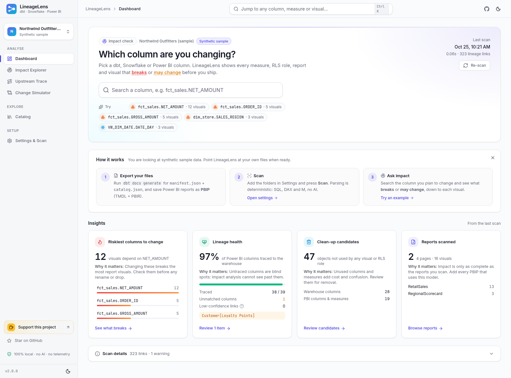
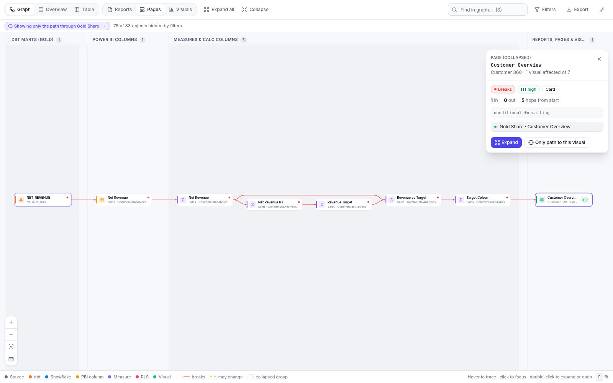
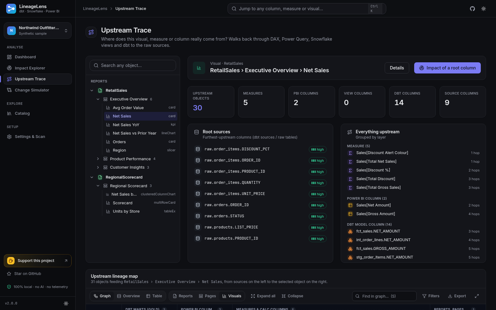
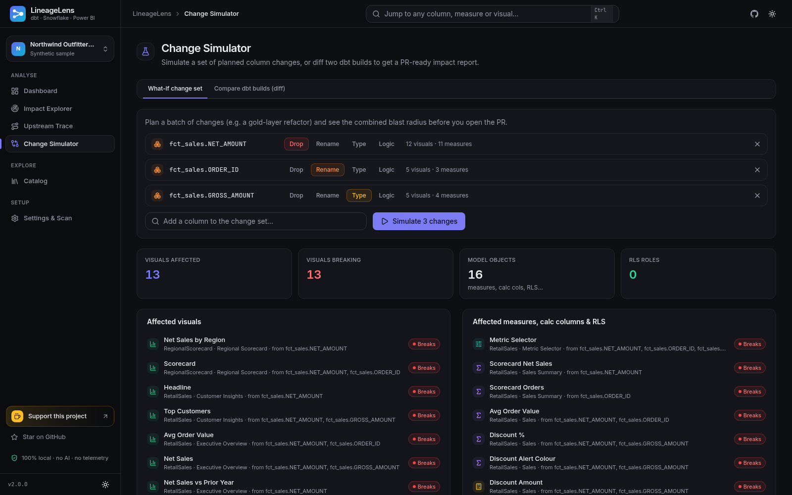
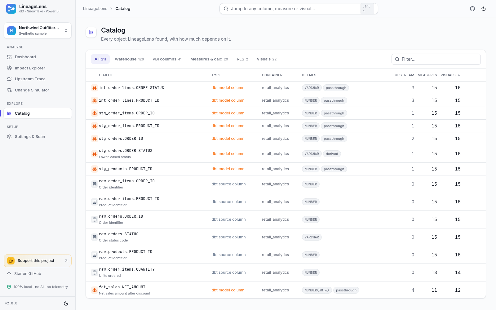

<div align="center">

# LineageLens

**Column-level impact analysis from dbt and Snowflake to the exact Power BI visual.**
*"I'm about to change this column. What breaks?"*

[](.github/workflows/ci.yml)
[](LICENSE)




</div>

Pick a gold-layer column and LineageLens shows everything downstream of it:

```
dbt model column ─▶ Snowflake view column ─▶ Power BI model column ─▶ calculated columns / measures
                                                                   ─▶ RLS roles, calculation-group items, field parameters
                                                                   ─▶ report ▸ page ▸ visual (incl. visual, page and report filters)
```

It also works the other way round: pick a visual, measure or RLS role and trace it back to the source columns.

## Features

- **Impact Explorer.** Choose a column and a change type (drop, rename, type, logic). Every affected measure, RLS role, report, page and visual is marked **breaks** or **may change**, with a confidence level and the full path.
- **A lineage map that stays readable at scale.** Swim lanes per layer, crossing minimisation, groups that collapse automatically, merged edges, hover-to-trace, focus/isolate a path, depth and type filters, search inside the graph, a minimap, an overview mode, a table view, keyboard shortcuts and PNG/SVG export.
- **Upstream Trace.** Trace a visual or measure back through DAX, Power Query, Snowflake views and dbt to the raw sources.
- **Change Simulator.** Combine several planned changes, or diff two dbt builds into a PR-ready markdown report. The CLI can fail a CI build when a change would break Power BI.
- **Catalog and clean-up.** Every object with its downstream counts. Find unused gold columns and unused PBI objects.
- **Local, offline and deterministic.** It runs on `127.0.0.1` and makes no outbound calls by default. There is no telemetry. It parses SQL (sqlglot), DAX, M, TMDL and PBIR with plain rules: **no AI, LLM or RAG**. The same input always gives the same answer.
- **Light and dark themes.** Works on Windows, macOS and Linux.

| Impact (large sample, focused path) | Upstream trace (dark) |
|---|---|
|  |  |
| **Change simulator** | **Catalog** |
|  |  |

### Inputs

| Source | What to give LineageLens |
|---|---|
| dbt | `target/manifest.json` (from `dbt compile`) and `target/catalog.json` (from `dbt docs generate`) |
| Power BI | A PBIP project: the `.SemanticModel` folder (TMDL or model.bim) and the `.Report` folder (PBIR, or legacy report.json) |
| Snowflake (optional) | A folder of `CREATE VIEW` `.sql` files for views that dbt does not manage, or read-only live metadata |

Only **synthetic sample data** ships with the app: *Northwind Outfitters* (standard, about 210 objects) and *Helios Retail Group* (large, about 940 objects, 7 reports, 151 visuals). Switch between them in **Settings & Scan**, or start with `lineagelens serve --sample large`.

---

## 1. Quickstart

You need **Python 3.11+**. Nothing else is required: the web UI is pre-built.

### Windows

1. Unzip `lineagelens-release.zip`, for example to `C:\Tools\lineagelens`.
2. Double-click **`start.bat`**. The first run creates `.venv` and installs the pinned dependencies (about a minute). Later runs start straight away.
3. Your browser opens at http://localhost:8765 with the sample project loaded.

```bat
start.bat                          :: sample project
start.bat -c C:\analytics\lineagelens.yml   :: your own configuration
start.bat --port 9000 --no-browser
```

### macOS / Linux

```bash
unzip lineagelens-release.zip && cd lineagelens
./start.sh                         # sample project
./start.sh -c ~/analytics/lineagelens.yml
```

### Manual install (any OS)

```bash
python -m venv .venv
.venv/bin/pip install .            # Windows: .venv\Scripts\pip install .
.venv/bin/lineagelens serve
```

Behind a corporate proxy, set `HTTPS_PROXY` or `PIP_INDEX_URL` (your internal mirror) before the first start.
To upgrade, replace the folder and delete `.venv` so the launcher reinstalls.

---

## 2. Point it at your own project

```bash
lineagelens init lineagelens.yml   # writes a commented starter config
# edit the paths, then:
lineagelens serve -c lineagelens.yml
```

You can also do this in the app: open **Settings & Scan**, enter a path, paste or edit the YAML, then click **Save & scan**.

### 2.1 dbt: produce `manifest.json` (and `catalog.json`)

LineageLens reads dbt **artifacts**, not Jinja. Run these in your dbt project:

```bash
dbt deps
dbt compile            # target/manifest.json with compiled SQL for every model (Jinja resolved)
dbt docs generate      # target/catalog.json with real column names and data types from Snowflake
```

* `compiled_code` in the manifest is what gets parsed. Models without compiled SQL are listed as warnings.
* `catalog.json` is optional but strongly recommended. It lets `SELECT *` and unqualified columns resolve exactly.
* Point `dbt.project_dir` at the project folder; it expects `target/`. You can also set `manifest:` / `catalog:` explicitly.

### 2.2 Snowflake views not managed by dbt

There are two options:

* **Folder of DDL scripts** (offline): `snowflake.view_dirs: [path/to/views]`. Each file may contain one or more `CREATE [OR REPLACE] [SECURE] VIEW ... AS SELECT ...` statements.
* **Live, read-only** (optional): see §5.

### 2.3 Power BI: save as PBIP (TMDL + PBIR)

The binary `.pbix` data model cannot be parsed reliably, so save your files as a **Power BI Project**:

1. In Power BI Desktop, go to *File ▸ Options and settings ▸ Options ▸ Preview features* and enable **Power BI Project (.pbip) save option**, **Store semantic model using TMDL format**, and **Store reports using enhanced metadata format (PBIR)**. On recent Desktop builds PBIR / TMDL are already the default.
2. Choose *File ▸ Save as ▸ Power BI project (*.pbip)*.
3. You get `MyReport.SemanticModel/` (TMDL) and `MyReport.Report/` (PBIR `definition/` folder, or the legacy `report.json`) next to `MyReport.pbip`. Commit them to git.
4. Add the folders to `powerbi.semantic_models` / `powerbi.reports`, or simply list a parent folder in `powerbi.search_dirs` so they are discovered automatically.

Thin reports (live-connected to a published semantic model) are matched to the model by name. Override the match with `powerbi.report_model_map`. `.pbix` files are supported for the **report layer** only (pages, visuals, filters).

### 2.4 Optional: exact DAX dependencies

DAX references are parsed deterministically. If you want the engine's own answer as well, run `EVALUATE INFO.CALCDEPENDENCY()` in DAX Studio against the model, save the result as CSV and configure `powerbi.calcdependency_csv: {ModelName: path.csv}`. Those links are then added with high confidence.

---

## 3. What you can do in the app

| Page | What it is for |
|---|---|
| **Dashboard** | Starts with "Which column are you changing?": a search box, your recent columns and suggestions. Four insight cards follow (riskiest columns, lineage health, clean-up candidates, reports scanned), each saying why it matters and linking to the details. Scan details are collapsible, and there is a short how-it-works guide. |
| **Impact Explorer** | Choose one or more columns and a change type (*drop*, *rename*, *type change*, *logic change*). You get an interactive lineage graph, the report ▸ page ▸ visual tree (with page and report filter badges), the semantic-model objects (RLS, measures, calc columns, calc items, field parameters) and the warehouse objects. Each item shows **breaks** vs **values may change**, its confidence and the full path. Export to HTML, XLSX, CSV or JSON. |
| **Upstream Trace** | Pick a report, page, visual, measure or RLS role and see every warehouse column it depends on. Root source columns are highlighted. |
| **Change Simulator** | *What-if:* combine several column changes into one change set. *Diff:* compare two dbt builds (old/new `manifest.json`, project folders, `.db` snapshots or configs) and get the changed columns, the affected Power BI objects and a PR-ready markdown summary. |
| **Catalog** | Every object, searchable and sortable, with its downstream counts. Filter to unused warehouse columns or PBI objects. |
| **Settings & Scan** | Edit the config, run a re-scan with live progress, view warnings, see the privacy statement. |

Press **Ctrl/⌘ + K** anywhere to search objects. Light and dark themes follow your OS; toggle them in the header or the sidebar. In the lineage map: `F` fits, `+`/`-` zoom, `S` searches, `E`/`C` expand/collapse all, `I` isolates the selection, `O` overview, `T` table, `Esc` clears the selection.

### How severity is decided

* **breaks**: the object selects the changed column directly (passthrough or rename chain), or references it by name in DAX / visuals / filters / RLS. Dropping or renaming the column makes it fail.
* **values may change**: the column is only used inside an expression, a join, a WHERE / GROUP BY or a filter. The object still runs, but its numbers can change. For *logic* and *type* changes, most items fall into this group.
* **confidence**: *high* means an exact name or `sourceColumn` match. *medium* means a match after naming-rule normalisation (case, prefixes, `Net Amount` ↔ `NET_AMOUNT`, regex map). *low* means a fuzzy match. Low and medium matches are labelled everywhere so you can review them.

---

## 4. CLI

```bash
lineagelens scan     -c lineagelens.yml                       # build and save the lineage graph
lineagelens impact   fct_sales.NET_AMOUNT --change rename      # tree of affected visuals, measures, RLS
lineagelens impact   "Sales[Net Amount]" -o impact.xlsx       # .html .xlsx .csv .json
lineagelens upstream "pbi:RetailSales:rls:EMEA Only"          # trace an object back to its source columns
lineagelens export   fct_sales.NET_AMOUNT -o report.html
lineagelens diff     old/target/manifest.json new/target/manifest.json -c lineagelens.yml \
                     -m impact.md --fail-on breaking          # exit code 1 when something breaks
lineagelens init     lineagelens.yml
lineagelens samples  ./lineagelens-samples                    # copy the synthetic sample project
lineagelens serve    -c lineagelens.yml --port 8765
```

Objects can be given as node ids, `model.COLUMN`, `DB.SCHEMA.VIEW.COLUMN`, `'Table'[Column]`, a measure name, or a visual / page / report name.

### CI (pull-request gate)

Ready-to-adapt pipelines are in `ci/`:

* `ci/github-actions.yml`: compiles dbt for the base and head commits, runs `lineagelens diff`, posts the markdown as a sticky PR comment and fails on breaking impact.
* `ci/azure-pipelines.yml`: the same for Azure DevOps (publishes the report as an artifact and as a build summary).

Both expect the PBIP folders and `lineagelens.yml` to be available in the checkout.

---

## 5. Optional connections (off by default)

### Live Snowflake (read-only metadata)

```yaml
snowflake:
  live: { enabled: true, databases: [ANALYTICS], schemas: [REPORTING] }
```

```bash
pip install ".[snowflake]"
set SNOWFLAKE_ACCOUNT=xy12345.west-europe.azure   # macOS/Linux: export ...
set SNOWFLAKE_USER=me@corp.com
set SNOWFLAKE_AUTHENTICATOR=externalbrowser       # SSO; or SNOWFLAKE_PASSWORD / SNOWFLAKE_PRIVATE_KEY_PATH
set SNOWFLAKE_ROLE=ANALYST
set SNOWFLAKE_WAREHOUSE=XS_WH
```

This only runs `INFORMATION_SCHEMA.COLUMNS`, `INFORMATION_SCHEMA.VIEWS` and `GET_DDL('VIEW', …)`, tagged `QUERY_TAG=lineagelens-readonly-metadata`. No table data is read. Credentials come from environment variables only and are never stored.

### Power BI / Fabric workspace pull (experimental)

```yaml
powerbi:
  fabric: { enabled: true, workspaces: ["<workspace-guid>"] }
```

This downloads semantic-model (TMDL) and report (PBIR) definitions with the Fabric REST `getDefinition` APIs into a local cache, then parses them exactly like PBIP files. Auth: set `FABRIC_TOKEN` (for example `az account get-access-token --resource https://api.fabric.microsoft.com`), or `pip install ".[fabric]"` for interactive sign-in. It needs Contributor access on the workspace. It has **not been tested against a live tenant** yet, so prefer PBIP files from git when you can.

---

## 6. Configuration reference

Paths are relative to the config file, unless you set `base_dir`. `~` and `%VARS%` / `$VARS` are expanded.

```yaml
project_name: Contoso analytics

dbt:                                   # one or more dbt projects
  - project_dir: ../dbt-gold           # uses target/manifest.json and target/catalog.json
    manifest: null                     # optional explicit paths
    catalog: null

snowflake:
  view_dirs: [../snowflake/views]      # CREATE VIEW scripts not managed by dbt
  default_database: ANALYTICS          # used for unqualified names
  default_schema: REPORTING
  live: { enabled: false, databases: [ANALYTICS], schemas: [] }

powerbi:
  semantic_models: [../powerbi/Sales.SemanticModel]  # TMDL folders or model.bim
  reports: [../powerbi/Sales.Report]                 # PBIR folders or legacy report.json folders
  pbix: []                                            # .pbix: report layer only
  search_dirs: [../powerbi]                           # auto-discover *.SemanticModel / *.Report / *.pbix
  report_model_map: { "Exec Overview": "Sales" }      # thin report -> model name
  calcdependency_csv: { Sales: ../exports/sales_calcdep.csv }
  fabric: { enabled: false, workspaces: [] }

naming:                                # how PBI column names map to warehouse columns
  case_insensitive: true
  strip_prefixes: [DIM_, FCT_]
  strip_suffixes: [_KEY]
  regex_map: [{ pattern: "^AMT_", replace: "AMOUNT_" }]
  enable_fuzzy: true                   # fuzzy matches are labelled "low" confidence
  fuzzy_threshold: 90

database: null                         # where the lineage graph is saved (SQLite). Default: per-user data folder
base_dir: null                         # resolve relative paths against this folder instead of the config's folder
```

**Data folder:** `%LOCALAPPDATA%\LineageLens` on Windows and `~/.lineagelens` on macOS / Linux. Override it with the `LINEAGELENS_HOME` environment variable. It only holds the saved graph per project.

---

## 7. Privacy and security

* The server binds to `127.0.0.1` only. There are no analytics, no update checks and no CDN fonts or scripts; everything is bundled.
* Your SQL, DAX and model metadata never leave the machine. The only outbound connections are the optional Snowflake / Fabric pulls above, and only when you enable them.
* The app reads your files; it never writes to your dbt or Power BI folders.

---

## 8. Limitations (please read)

LineageLens only sees what is in the artifacts you give it. Known gaps:

* **Excel / Analyze in Excel, and other external tools.** PivotTables, cube formulas, Power Automate, composite models built on top of yours, and third-party tools that query the semantic model are invisible. A column can look "unused" here and still be used in Excel. Check the Power BI *lineage view* / *usage metrics* or the XMLA query logs before dropping anything.
* **Paginated reports (.rdl)** are not parsed.
* **Dashboards and tiles, apps, subscriptions, metrics/scorecards** are not parsed.
* **Dynamic M.** Connection details built at refresh time (dynamic M parameters, `Expression.Evaluate`, functions that compose table names, `Value.NativeQuery` with concatenated SQL) are resolved only when the values are literal or simple parameters. Otherwise the table gets a warning and falls back to name matching.
* **Field parameters.** All columns and measures listed in a field parameter are linked. Which one a viewer has selected is runtime state; the PBIR file only stores the last-saved selection.
* **Jinja is only understood through compiled SQL.** Run `dbt compile` (and `dbt docs generate`). Macros that emit SQL at run time (e.g. `run_query` results that differ per environment) appear as compiled for the target you used.
* **SQL coverage.** Standard Snowflake SELECT / CTE / JOIN / UNION / window / QUALIFY / LATERAL FLATTEN statements are supported. `SELECT *` needs `catalog.json` (or live metadata) to expand exactly. Very dynamic SQL (stored procedures, `IDENTIFIER()`, `EXECUTE IMMEDIATE`) is not traced.
* **DAX.** References are parsed exactly, but the meaning of a calculation is not evaluated. For example, `ALL(Table)` depends on every column, and DAX strings built at runtime are not followed. Use the optional `INFO.CALCDEPENDENCY` CSV for the engine's own dependency list.
* **Visual-level details.** Custom visuals are supported when they use standard data roles. Conditional formatting, sort-by and tooltip fields are detected when they are present in the PBIR / layout JSON. Bookmarks and drill-through targets are not modelled as dependencies.
* **.pbix** files give the report layer only (the binary model is not decoded); save as PBIP for the model.
* **Name matching.** Columns renamed in Power Query are traced through `Table.RenameColumns`. Other transformations (`Table.TransformColumnNames` with custom functions, merges, unpivots) fall back to the naming rules and are marked medium / low confidence.

---

## 9. Development

```bash
python -m venv .venv && .venv/bin/pip install -e ".[dev]"
.venv/bin/pytest                         # 48 tests: parsers, impact, diff, export, API, CLI, links
cd frontend && npm ci
npm run typecheck && npm test            # TypeScript + 12 vitest tests (graph layout)
npm run build                            # React + TS + Vite + Tailwind, outputs to lineagelens/static
npm run dev                              # dev server on :5173, proxies /api to :8765
```

Project layout:

```
lineagelens/            Python package (FastAPI server, Typer CLI, parsers, graph, exports)
  extractors/           dbt, snowflake, dax, mquery, pbimodel (TMDL/BIM), reports (PBIR/legacy/pbix), fabric
  samples/              synthetic dbt + Snowflake + Power BI sample project
  static/               built web UI
frontend/               React source
tests/                  pytest suite
ci/                     GitHub Actions and Azure DevOps examples
tools/                  generators for the synthetic samples
```

---

## 10. Support the project

If LineageLens saves you a broken dashboard, you can support it:

- **Buy me a coffee**: the button in the sidebar footer.
- **Star on GitHub**: the link in the sidebar and header.

Both are plain links: no scripts, no tracking. Set them in **one place**, `lineagelens/links.py`:

```python
BUYMEACOFFEE_URL = "https://www.buymeacoffee.com/YOUR_USERNAME"
GITHUB_REPO_URL = "https://github.com/YOUR_USERNAME/lineagelens"
```

You can also override them with the `BUYMEACOFFEE_URL` and `GITHUB_REPO_URL` environment variables. An empty value hides the button, and only `http(s)` URLs are accepted.

## 11. Contributing and license

Contributions are welcome. See [CONTRIBUTING.md](CONTRIBUTING.md), [CODE_OF_CONDUCT.md](CODE_OF_CONDUCT.md) and [SECURITY.md](SECURITY.md). Changes are listed in [CHANGELOG.md](CHANGELOG.md).

Please **never attach real company SQL, models or data** to issues. Use the synthetic samples, or a minimal anonymised reproduction.

Released under the [MIT License](LICENSE) © 2026 Dhruvpuri Goswami.
